# stacklight-oee-vision

Read the red / amber / green andon stack lights on old machines with a camera, and turn them into machine states, downtime events and OEE **availability**, published as JSON (and optionally MQTT).

Pure Python + numpy. No OpenCV needed for the core, the tests or the simulator.

## Why

Many machines in the field have no PLC access, no data port, or a controller nobody is allowed to touch. They almost always have a stack light, though, and the light already encodes the machine state for the operators. A fixed camera pointed at the lights is a non-invasive way to get that state into software, without opening the control cabinet or changing the machine.

What you get from it:

- a state per machine: `RUNNING`, `IDLE`, `SETUP`, `FAULT`, `OFF`
- timestamped state-change events with the duration of the previous state
- availability, MTBF, MTTR and downtime by reason over any time window

## How it works

```mermaid
flowchart LR
    CAM[Camera / RTSP<br/>or simulator] --> FR[RGB frame]
    FR --> GAIN[scene gain<br/>median brightness]
    FR --> DET[detect.py<br/>HSV lamp ROIs<br/>rolling off-baseline]
    GAIN --> DET
    DET -->|lamp on/off per frame| TMP[temporal.py<br/>flicker filter<br/>blink detection]
    TMP -->|OFF / STEADY / BLINK per lamp| ST[state.py<br/>pattern to state<br/>min-dwell state machine]
    ST -->|events: machine, from, to, ts, duration_s| OEE[oee.py<br/>availability, MTBF, MTTR]
    ST --> OUT[JSON lines / MQTT<br/>factory/line/machine/state]
    OEE --> OUT
```



1. **Detect.** Each lamp has a small rectangle (ROI) in the config. RGB is converted to HSV with a vectorised numpy routine. A pixel counts as lit if its hue is in the lamp's colour band, it is saturated, and it is clearly brighter than that lamp's own "off" level. The off level is a rolling baseline measured relative to the whole scene's brightness, and it only updates while the lamp is off. A slow day/night change, or someone switching the room lights, moves the threshold with the scene instead of causing false alarms.
2. **Temporal.** A single-frame median filter removes flicker. A sliding 2 s window then classifies each lamp as `OFF`, `STEADY` or `BLINK` (at least 3 transitions, spaced at most 0.7 s apart, at 0.7 to 4 Hz). Blinking amber is a different state from steady amber.
3. **State.** Red (steady or blinking) is `FAULT`; blinking amber is `SETUP`; steady amber is `IDLE`; green is `RUNNING`; nothing lit is `OFF`. A change is only committed after it has lasted `min_dwell_s` (1 s). The event is back-dated to when the new pattern actually started, so the dwell filter does not add delay to the timestamps.
4. **OEE.** Events become intervals; intervals become availability, MTBF, MTTR and seconds per state.

## Quickstart

```bash
pip install -e .[dev]          # numpy + pytest
python -m stacklight simulate  # synthetic 3-machine line, 300 s
python -m pytest -q
```

Options:

```bash
python -m stacklight simulate --duration 600 --seed 3 --json out.jsonl
python -m stacklight simulate --mqtt localhost            # needs: pip install -e .[mqtt]
python -m stacklight camera --source rtsp://... --config my_line.json   # needs: pip install -e .[camera]
```

`examples/line_config.json` describes the three-machine layout the simulator draws. For a real camera, copy it and set the lamp rectangles in your camera's pixel coordinates.

MQTT messages go to `factory/<line>/<machine>/state` (QoS 1, retained):

```json
{"line": "line-1", "machine": "press-01", "from": "RUNNING", "to": "IDLE", "ts": 45.2, "duration_s": 45.2}
```

### Sample output

Real run of `python -m stacklight simulate` (first 10 of 26 events, then the summary):

```
Simulating 3 machines for 300s at 10 fps (noise, flicker, day/night drift, light switch)

[   15.8s] lathe-02   SETUP   -> RUNNING (previous state lasted 15.8s)
[   30.2s] packer-03  RUNNING -> OFF     (previous state lasted 30.2s)
[   45.2s] press-01   RUNNING -> IDLE    (previous state lasted 45.2s)
[   55.2s] packer-03  OFF     -> RUNNING (previous state lasted 25.0s)
[   57.2s] press-01   IDLE    -> RUNNING (previous state lasted 12.0s)
[   85.5s] lathe-02   RUNNING -> FAULT   (previous state lasted 69.7s)
[   97.2s] press-01   RUNNING -> FAULT   (previous state lasted 40.0s)
[   97.8s] lathe-02   FAULT   -> RUNNING (previous state lasted 12.3s)
[  110.2s] packer-03  RUNNING -> FAULT   (previous state lasted 55.0s)
[  115.2s] press-01   FAULT   -> RUNNING (previous state lasted 18.0s)
...

machine      avail   run s  idle s  setup s  fault s  off s faults  MTBF s  MTTR s
----------------------------------------------------------------------------------
press-01     74.9%     225      37       20       18      0      1     225      18
lathe-02     75.6%     212      25       31       12     20      1     212      12
packer-03    79.8%     220      18       22       15     25      1     220      15

vs scripted ground truth: 99.11% of frames labelled correctly, 26/26 transitions within 1s (mean error 0.30s), 0 spurious events
Note: availability only. Performance and quality need part counts, which lamps do not carry.
```

## Accuracy

The simulator (`stacklight/sim.py`) renders 320x240 video of three towers from a scripted timeline, with sensor noise (sigma 0.02), random one-frame lamp dropouts (1% per lit lamp per frame), exposure jitter, a slow day/night brightness ramp, and a sudden "lights off" period that cuts the room brightness to 35% for 15% of the run. Machines cover all five states; two of them use blinking amber for setup and one uses blinking red for faults.

The end-to-end test (`tests/test_e2e.py`, 180 s, 3 machines, 5400 frames) scores the pipeline against the script:

| Metric | Result |
|---|---|
| Frames labelled with the correct state | **99.24%** (requirement: at least 95%) |
| Scripted transitions found | **13 / 13** |
| Transition timing error | mean 0.32 s, max 0.80 s (requirement: within 1 s) |
| Spurious events | 0 |
| Availability vs scripted value | within 2 percentage points |

The 300 s CLI run above gives 99.11% and 26/26 transitions. Remaining errors are the detection delay around each transition (about 0.3 s on average, more for blink patterns, which need a few transitions before they can be recognised).

These numbers are against a simulator that I wrote, with noise I chose. They show the logic is consistent. They do not show it works on a factory floor.

## Limits / what is not verified

- **Not tested on a real camera or a real factory.** Everything above is synthetic. The OpenCV and MQTT code paths are small, but they have not been exercised against a live RTSP stream or broker.
- **Colour calibration is needed per site.** Hue bands (`HUE_BANDS` in `detect.py`) and thresholds are tuned for the simulator. Real LEDs, lens tints, white balance and auto-exposure will need adjustment. Amber vs red separation is the most likely trouble spot.
- **Geometry.** ROIs are fixed rectangles. If the camera moves, they must be re-placed. Steep viewing angles, small lamps in the frame (aim for roughly 10 pixels or more across) and lamps seen edge-on will reduce accuracy.
- **Occlusion and glare.** People, forklifts or sunlight on the lens can hide or fake a lit lamp. Nothing here detects that; a hidden lamp looks like an off lamp.
- **Auto-exposure.** The baseline copes with smooth brightness changes. A camera that re-exposes aggressively when a lamp turns on can still confuse it.
- **Frame rate and blink.** Blink detection assumes 1 to 2 Hz blinking sampled at about 10 fps. Faster blinking or a low-fps stream (aliasing) will be misread.
- **Meaning of the lights is assumed.** Green = running, amber = idle/setup, red = fault is a common convention, not a rule. Some machines use other colours or a different code. The mapping lives in `state.classify`.
- **OEE is availability only.** Full OEE is availability x performance x quality. Performance needs an ideal cycle time and a part count; quality needs good/total counts. A stack light provides neither, so the tool does not report them. Availability here is run time divided by planned time, where `OFF` time is excluded from planned time (`include_off` changes that). MTBF is run time per fault, MTTR is mean fault duration.
- A single global scene-brightness reference is used (median of the frame). Scenes where a large part of the image changes brightness for other reasons (for example a large screen) would need a dedicated reference region.

## Next steps

- A tiny classifier (ONNX) on lamp crops, to replace the hand-set HSV bands and cope with real colour variation.
- Edge deployment on a Jetson or Raspberry Pi, reading directly from the camera.
- OPC UA and MQTT Sparkplug B output, so states appear as standard device metrics.
- A calibration helper to place ROIs and tune hues from a reference image.
- Optional part counting from a second signal (door sensor, beam, or vision) to get performance and quality.

## Repository layout

```
stacklight/       config, detect, temporal, state, oee, sim, pipeline, camera, mqtt_out, cli
examples/         line_config.json (3 machines)
tests/            HSV, detection under drift, blink, state/dwell, OEE maths, end-to-end
```

## License

MIT, see `LICENSE`.
